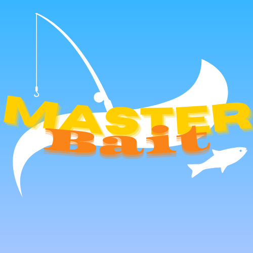
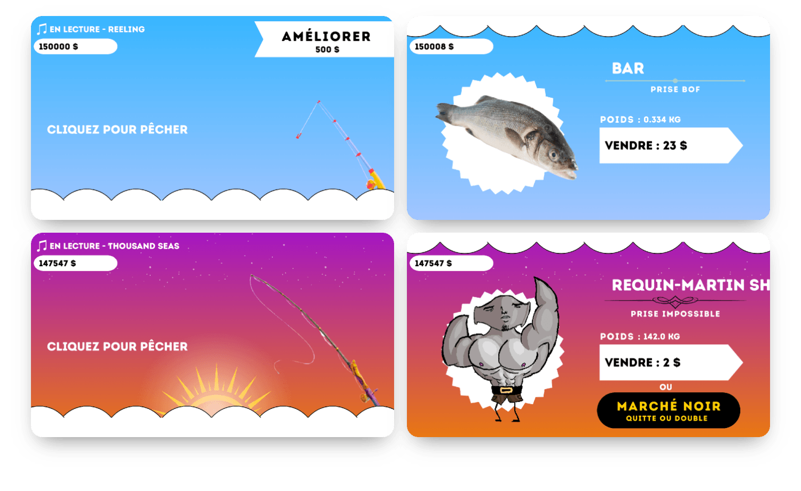

<p align="center">
  
</p>

<h1 align="center">MasterBait</h1>

<p align="center">
  <strong>Lance ta ligne, revends tes prises, améliore ta canne… et ne réveille pas Cthulhu.</strong><br>
  Jeu de pêche en 2D développé en Python avec Pygame.
</p>

<p align="center">
  
</p>

<p align="center">
  
  
  
  <a href="https://github.com/sami-krm/MasterBait/releases"></a>
</p>

<p align="center">
  <a href="https://github.com/sami-krm/MasterBait/releases/latest"><strong>⬇️ Télécharger la version Windows</strong></a>
</p>

---

## Sommaire

- [Le jeu](#le-jeu)
- [Lancer le jeu](#lancer-le-jeu)
- [Sauvegarde](#sauvegarde)
- [Structure du projet](#structure-du-projet)
- [Documentation](#documentation)

## Le jeu

### 🎣 Pêche
- Lance ta ligne d'un clic et découvre ta prise : **plus de 35 espèces**, de l'anchois à la baleine bleue en passant par le requin blanc.
- Chaque poisson a un **poids aléatoire** et une **rareté** : plus il est lourd, plus il vaut cher.
- **Poissons dorés** : 5 % de chances qu'une prise soit en or, et elle se vend **trois fois plus cher**.

### 🛒 Boutique
- **Revends** tes prises pour gagner de l'argent.
- **Améliore ta canne** sur **6 niveaux** : chaque niveau ouvre de nouvelles espèces, plus rares et plus précieuses.

### 🐙 Cthulhu
- Les abysses cachent une créature à ne pas pêcher… Le jeu réserve une fin particulière à ceux qui vont trop loin.

### 🎵 Ambiance
- **Bande-son originale** de plus de quinze morceaux (*Anchois Lullaby*, *Golden Squid*, *Turbot Mode*…), effets sonores et sprites dessinés pour le jeu.

## Lancer le jeu

### Version Windows (.exe)

Télécharge `MasterBaitEXE.zip` dans les [Releases](https://github.com/sami-krm/MasterBait/releases), décompresse-le, puis lance `MasterBait.exe`.

### Version Python

**Prérequis :** Python 3.9 ou plus récent et pygame 2.3 ou plus récent.

```bash
git clone https://github.com/sami-krm/MasterBait.git
cd MasterBait
pip install pygame
python MasterBait.py
```

> Lance le jeu depuis le dossier du projet : il charge `Assets/` et `save.txt` en chemin relatif.

## Sauvegarde

La progression est enregistrée dans `save.txt`, une valeur par ligne :

| Ligne | Valeur | Départ |
|---|---|---|
| 1 | Argent | `0` |
| 2 | Niveau de la canne (1 à 6) | `1` |
| 3 | Compteur d'anchois | `0` |

Ferme le jeu avant de modifier ce fichier.

## Structure du projet

```
.
├── MasterBait.py         # code du jeu
├── save.txt              # sauvegarde (état initial)
├── requirements.txt      # versions de Python et pygame
└── Assets/
    ├── Audio/
    │   ├── Musiques/     # bande-son
    │   └── SFX/          # effets sonores
    ├── Font/             # police
    ├── Sprites/
    │   ├── Cannes/       # les 6 cannes à pêche
    │   ├── Poissons/     # poissons normaux et dorés
    │   └── UI/           # décors, boutons, écrans
    └── icone.png         # icône du jeu
```

## Documentation

- [`Cahier_des_Charges_projet_MasterBait.pdf`](Cahier_des_Charges_projet_MasterBait.pdf) : cahier des charges du projet
- [`Doc.pdf`](Doc.pdf) : documentation

---

<p align="center">Projet de <a href="https://github.com/sami-krm">sami-krm</a>.</p>
